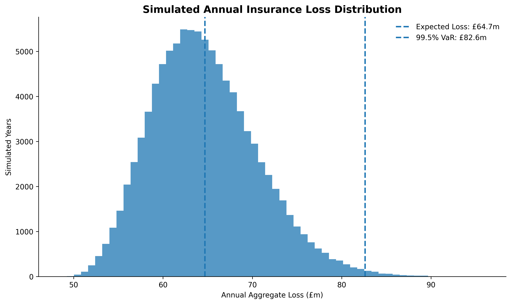
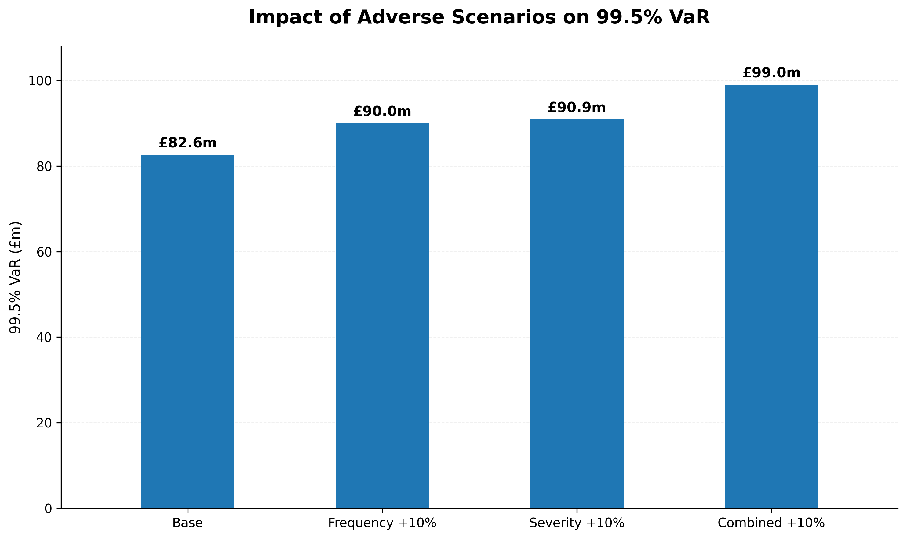
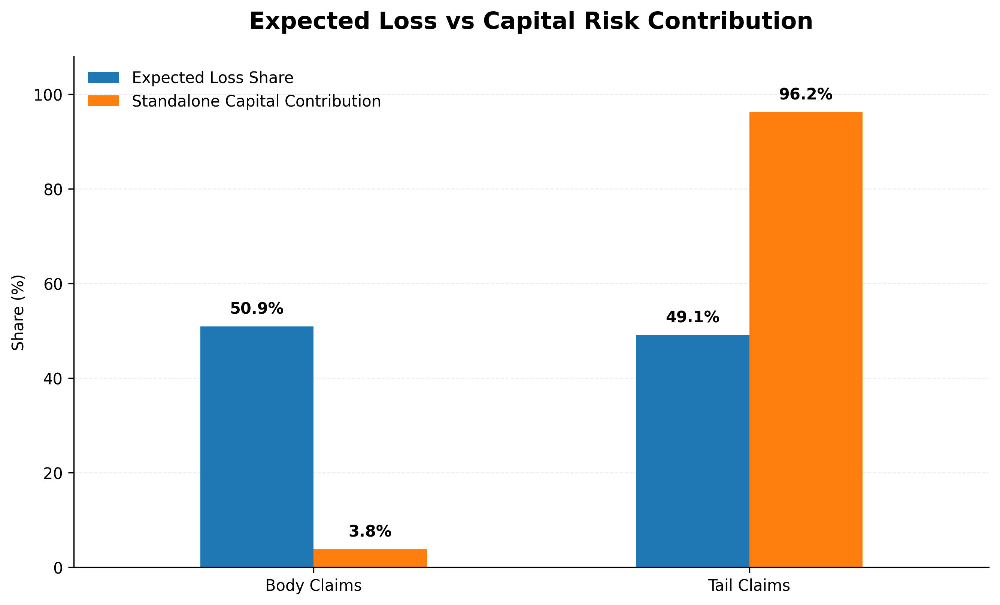

# General Insurance Capital & Risk Modelling

> A frequency–severity capital modelling case study using Python to quantify aggregate insurance losses, tail risk, stress scenarios and diversification.


## Key Results

| Metric | Result |
|---|---:|
| Expected Annual Loss | **£64.68m** |
| 99.5% VaR | **£82.63m** |
| 99.5% TVaR | **£85.17m** |
| Unexpected Loss at 99.5% | **£17.94m** |
| Capital Uplift over Expected Loss | **27.74%** |
| Combined +10% Stress VaR | **£98.97m** |
| Diversification Benefit | **£0.72m (3.85%)** |
| Tail Share of Standalone Capital | **96.23%** |

The central finding is that **expected loss and capital risk are driven by different aspects of the portfolio**. Body and tail claims contribute approximately equally to expected losses, but large-loss tail claims account for **96.23% of standalone unexpected-loss capital**.


## Project Overview

How much capital should a general insurer hold against losses that may be materially worse than expected?

This project develops a simplified general insurance capital risk model using the public **freMTPL2 French motor third-party liability dataset**. The analysis moves from policy-level claim frequency and individual claim severity modelling through to Monte Carlo simulation of annual aggregate insurance losses.

The objective is not simply to estimate expected claims. It is to understand the financial impact of **unexpected losses**, identify the risks driving capital requirements, and assess how the insurer's position changes under adverse scenarios.

The project covers:

- Data quality assessment and exploratory analysis
- Claim frequency modelling using Poisson and Negative Binomial approaches
- Heavy-tailed claim severity modelling
- Lognormal and Gamma distribution comparison
- Generalised Pareto modelling of large-loss severity
- Monte Carlo aggregate-loss simulation
- 95%, 99% and 99.5% Value at Risk (VaR)
- Tail Value at Risk (TVaR / Expected Shortfall)
- Frequency and severity stress testing
- Risk contribution and diversification analysis
- Management-focused interpretation of capital risk

> **Important:** The 99.5% VaR used in this project is an insurance-capital reference measure. The model is not intended to calculate a regulatory Solvency Capital Requirement (SCR).

---

## Contents

1. [Business Question](#business-question)
2. [Dataset](#dataset)
3. [Analytical Approach](#analytical-approach)
4. [Frequency Modelling](#frequency-modelling)
5. [Severity Modelling](#severity-modelling)
6. [Aggregate Loss & Capital Modelling](#aggregate-loss--capital-modelling)
7. [Stress Testing](#stress-testing)
8. [Risk Contribution & Diversification](#risk-contribution--diversification)
9. [Management Insights](#management-insights)
10. [Project Structure](#project-structure)
11. [Tools & Technologies](#tools--technologies)
12. [Model Scope & Limitations](#model-scope--limitations)

---

## Business Question

A general insurer needs to understand not only its expected annual claims cost, but also the potential financial impact of adverse insurance outcomes.

This project addresses the following management questions:

- What is the expected annual insurance loss?
- How volatile are annual aggregate losses?
- What losses could arise under extreme but plausible outcomes?
- What are the portfolio's 95%, 99% and 99.5% VaR levels?
- How severe are losses beyond the VaR threshold?
- How sensitive is the capital position to higher claim frequency and severity?
- Which component of the loss distribution contributes most to unexpected-loss capital?
- What diversification benefit arises when body and tail risks are combined?

The analysis is structured as a one-year insurance-risk modelling exercise, translating claim frequency and severity behaviour into management-focused capital metrics.

---

## Dataset

The project uses the public **freMTPL2 French motor third-party liability dataset**, consisting of:

- **677,991 policy-level observations** for claim frequency analysis
- **26,444 individual claim records** for severity analysis
- Policy exposure and rating characteristics for frequency modelling
- Individual claim amounts for severity and large-loss modelling

The raw data is preserved separately from the processed analytical data to maintain a clear and reproducible workflow.

Initial data-quality checks included:

- Missing-value assessment
- Duplicate-record review
- Exposure and claim-count validation
- Claim-amount validation
- Distribution and outlier assessment

The severity data showed substantial right-tail behaviour. Mean observed claim severity was approximately **£2,265.51**, while the largest observed claim was approximately **£4.08m**, demonstrating why tail modelling is important for capital analysis.

---

## Analytical Approach

The project follows an end-to-end actuarial modelling workflow:

**Data Quality → Exploratory Analysis → Frequency Modelling → Severity Modelling → Aggregate Loss Simulation → Capital Metrics → Stress Testing → Risk Contribution → Management Interpretation**

### 1. Frequency Risk

Policy-level claim frequency was analysed using Poisson and Negative Binomial models.

The Negative Binomial model provided the stronger fit to policy-level overdispersion, producing:

- Expected annual claims: **26,578.40**
- Observed annual claims: **26,444**
- Observed / Expected ratio: **0.9949**

For aggregate annual capital simulation, a portfolio-level Poisson count model was used as the base frequency assumption rather than applying the policy-level Negative Binomial dispersion parameter directly to the portfolio total.

### 2. Severity Risk

Claim severity exhibited a strongly right-skewed distribution with material large-loss exposure.

Lognormal and Gamma distributions were assessed for the claim-severity body. The Lognormal distribution provided the better overall fit, but both standard parametric distributions understated the extreme observed tail.

A composite severity framework was therefore adopted:

- **Body:** Lognormal modelling
- **Tail:** Generalised Pareto Distribution (GPD)
- **Tail threshold:** **£8,156.01** — the 97.5th percentile
- **Maximum modelling loss:** **£4,075,400.56**

The modelling limit prevents the fitted heavy-tailed GPD from generating implausibly unbounded losses while preserving the observed large-loss behaviour relevant to capital analysis.

### 3. Aggregate Loss Simulation

Annual insurance losses were modelled using a hybrid Monte Carlo framework.

High-volume body claims were aggregated efficiently using their frequency–severity moments, while large-loss tail claims were simulated explicitly from the fitted and capped GPD.

This approach preserves the behaviour of the extreme-loss tail without requiring billions of individual claim simulations.

The resulting annual aggregate-loss distribution forms the basis for VaR, TVaR, stress testing and unexpected-loss capital analysis.

---

## Frequency Modelling

Claim frequency was modelled at policy level using Poisson and Negative Binomial GLMs.

The Poisson model showed evidence of overdispersion, while the Negative Binomial specification improved model fit:

| Model | Log-Likelihood | AIC | Deviance |
|---|---:|---:|---:|
| Poisson GLM | -108,032.97 | 216,087.94 | 165,297.80 |
| Negative Binomial GLM | **-107,689.83** | **215,401.66** | **143,575.54** |

Portfolio-level validation showed close agreement between observed and expected claims:

- Observed claims: **26,444**
- Expected claims: **26,578.40**
- Observed frequency: **0.0738**
- Expected frequency: **0.0741**
- O/E ratio: **0.9949**

The model therefore provides a reasonable central estimate of portfolio claim frequency, while the remaining variation and segmentation results highlight the importance of monitoring frequency risk.

---

## Severity Modelling

Claim severity was highly right-skewed:

- Mean severity: **£2,265.51**
- Median severity: **£1,172.00**
- 99th percentile: **£16,451.22**
- 99.5th percentile: **£34,376.96**
- 99.9th percentile: **£152,223.24**
- Maximum observed claim: **£4.08m**

Losses were also highly concentrated. The largest **1% of claims generated approximately 38.0% of total observed loss**, while the largest 10% generated approximately 59.9%.

Standard Lognormal and Gamma models were unable to reproduce the extreme observed tail adequately. A Generalised Pareto Distribution was therefore fitted above the 97.5th percentile threshold.

The selected tail model reproduced the extreme 99.9th percentile closely, supporting its use within the capital simulation subject to the modelling limit and assumptions documented in this project.

---

## Aggregate Loss & Capital Modelling

The final simulation produced:

- **Expected annual loss:** £64.68m
- **Annual loss standard deviation:** approximately £5.91m
- **99.5% VaR:** £82.63m
- **99.5% TVaR:** £85.17m
- **99.5% unexpected loss:** £17.94m
- **Capital uplift above expected loss:** 27.74%

At the 99.5% confidence level, the model therefore indicates an annual loss threshold approximately **£17.94m above expected annual losses**.



### Capital Metrics

| Confidence Level | VaR | TVaR | Unexpected Loss |
|---|---:|---:|---:|
| 95.0% | £75.20m | £78.52m | £10.52m |
| 99.0% | £80.58m | £83.34m | £15.90m |
| 99.5% | **£82.63m** | **£85.17m** | **£17.94m** |

---

## Stress Testing

Three illustrative adverse scenarios were tested against the base capital model:

- Claim frequency +10%
- Claim severity +10%
- Frequency and severity +10%

| Scenario | Expected Loss | 99.5% VaR | Unexpected Loss |
|---|---:|---:|---:|
| Base | £64.68m | £82.63m | £17.94m |
| Frequency +10% | £71.15m | £89.97m | £18.82m |
| Severity +10% | £71.15m | £90.89m | £19.74m |
| Combined +10% | £78.27m | **£98.97m** | **£20.70m** |



A 10% frequency increase and a 10% severity increase generate the same expected-loss increase, but severity deterioration produces the larger capital impact because it directly magnifies the heavy-tailed claim amounts.

Under the combined stress, 99.5% VaR increases by approximately **£16.34m**, or **19.78%**, relative to the base model.

---

## Risk Contribution & Diversification

Expected losses are almost evenly divided between ordinary body claims and large-loss tail claims:

- Body claims: **50.90% of expected loss**
- Tail claims: **49.10% of expected loss**

Their contribution to unexpected-loss capital is very different:

- Body claims: **3.77%**
- Tail claims: **96.23%**



This is one of the central findings of the project: **the claims generating expected cost are not necessarily the same claims driving capital risk**.

At the 99.5% level:

- Sum of standalone unexpected-loss capital: **£18.66m**
- Diversified unexpected-loss capital: **£17.94m**
- Diversification benefit: **£0.72m**
- Diversification benefit: **3.85%**

The relatively modest diversification benefit reflects the dominance of the large-loss tail in the portfolio's capital requirement.

---

## Management Insights

The modelling results point to several practical risk-management implications.

### 1. Large losses are the principal capital driver

Tail claims account for approximately half of expected claims cost but more than **96% of standalone unexpected-loss capital**. Management should therefore monitor large-loss experience separately from ordinary attritional claims.

### 2. Severity deterioration matters disproportionately

Although equivalent 10% frequency and severity stresses generate similar changes in expected loss, severity deterioration produces the greater increase in 99.5% capital risk.

This highlights the importance of:

- Monitoring large-loss trends
- Reviewing underwriting limits and concentrations
- Assessing the effectiveness of reinsurance protection
- Stress-testing severity assumptions regularly

### 3. Expected loss alone does not describe the insurer's risk position

Expected annual losses of approximately **£64.68m** represent the central claims cost, but the 99.5% loss threshold rises to **£82.63m**.

Capital analysis therefore adds information that cannot be obtained from expected-loss estimates alone.

### 4. Adverse movements can materially change capital needs

Under the combined +10% frequency and severity scenario, the modelled 99.5% VaR increases to approximately **£98.97m**.

This demonstrates why management should consider both central forecasts and adverse scenarios when assessing financial resilience.

---

## Project Structure

```text
General-Insurance-Capital-Risk-Modelling/
│
├── data/
│   ├── raw/
│   ├── processed/
│   └── README.md
│
├── docs/
│   ├── actuarial_analysis_framework.md
│   └── business_brief.md
│
├── notebooks/
│   ├── 01_data_quality_audit.ipynb
│   ├── 02_exploratory_analysis.ipynb
│   ├── 03_frequency_modelling.ipynb
│   ├── 04_severity_modelling.ipynb
│   └── 05_aggregate_loss_modelling.ipynb
│
├── outputs/
│   ├── figures/
│   │   ├── annual_loss_distribution.png
│   │   ├── stress_scenario_var.png
│   │   └── capital_risk_contribution.png
│   │
│   └── tables/
│       ├── capital_risk_metrics.csv
│       ├── stress_scenario_results.csv
│       ├── diversification_results.csv
│       └── capital_contribution.csv
│
├── reports/
├── src/
└── README.md


## Tools & Technologies

**Python**

- pandas — data preparation and analysis
- NumPy — numerical analysis and simulation
- SciPy — statistical distribution fitting and tail modelling
- statsmodels — Poisson and Negative Binomial frequency modelling
- Matplotlib — analytical visualisation

**Modelling Techniques**

- Exploratory data analysis
- Poisson GLM
- Negative Binomial GLM
- Lognormal severity modelling
- Gamma severity modelling
- Generalised Pareto Distribution
- Extreme-value tail modelling
- Monte Carlo simulation
- Value at Risk (VaR)
- Tail Value at Risk / Expected Shortfall
- Stress and scenario testing
- Risk contribution analysis
- Diversification analysis

---

## Model Scope & Limitations

This project is designed as an actuarial analytics case study rather than a regulatory capital model.

Important limitations include:

- The model considers insurance claim frequency and severity risk only.
- Market, counterparty/default, operational and other material insurer risks are outside the scope.
- The 99.5% VaR should not be interpreted as a regulatory Solvency Capital Requirement.
- Aggregate frequency modelling assumes a portfolio-level Poisson base process.
- Frequency and severity are modelled independently.
- Body and tail components are treated independently in the diversification analysis.
- The large-loss model depends on the selected GPD threshold and fitted parameters.
- A maximum modelling loss of £4.08m is applied to control the unbounded behaviour of the fitted heavy-tail distribution.
- Stress scenarios are illustrative management stresses rather than regulatory prescribed stresses.
- Historical claim experience may not fully represent future portfolio conditions.

These limitations are important when interpreting the capital estimates and provide areas for potential future model development.

---

## Potential Extensions

Future development could include:

- Alternative aggregate frequency assumptions
- Frequency–severity dependency
- Reinsurance structures and recoveries
- Multiple underwriting segments
- Correlated risk modules
- Alternative large-loss thresholds and limits
- Parameter and model uncertainty
- Capital allocation across business segments
- Scenario-based catastrophe losses
- Comparison of VaR with Expected Shortfall-based capital measures

---

## Reproducibility

The notebooks are organised sequentially and document the modelling workflow from raw-data validation through to the final capital analysis.

To reproduce the analysis, run the notebooks in numerical order:

`01 → 02 → 03 → 04 → 05`

Final analytical outputs are stored under `outputs/`, while the notebooks retain the underlying calculations, assumptions and validation steps.

---

## Author

**Anthony Utulu**  
Actuarial & Business Analytics

This project forms part of the **Anthony Utulu Analytics** portfolio, focused on applying actuarial thinking, statistical modelling and data analytics to practical insurance and business decisions.